### 1. De .cshtml a HTML.
**Explica qué le pasa a Surplus.cshtml desde que haces dotnet
build hasta que el navegador recibe el HTML. Compila con dotnet build
-p:EmitCompilerGeneratedFiles=true, busca la clase generada para Status.cshtml y
copia un WriteLiteral y un Write: ¿de qué parte de tu .cshtml sale cada uno? ¿Por qué
no hay ningún .cshtml dentro del contenedor? ¿En qué ensamblado acaban las páginas, y en cuál acababan antes de .NET 6?**

Al ejecutar el comando `dotnet build -p:EmitCompilerGeneratedFiles=true`, el proyecto se compila y se genera el archivo `NovaHarvest.Web.dll`.


Durante la compilación, Razor transforma los archivos `.cshtml` en código C# y los compila. Para comprobarlo, he buscado los archivos generados dentro de la carpeta `obj/Debug/net10.0/generated`. Allí he encontrado las páginas con extensión `.g.cs`, como `Surplus_cshtml.g.cs` y `Status_cshtml.g.cs`.
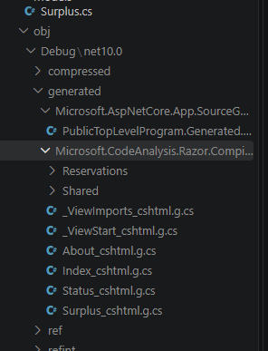
Dentro de estas clases generadas aparecen los métodos `WriteLiteral()` y `Write()`.

El `WriteLiteral()` sale directamente del contenido HTML que he escrito en el archivo `.cshtml`, como las etiquetas y los textos.

El `Write()` sale de las expresiones Razor que empiezan por `@`, como `@Model.ServerTime.ToString("dd/MM/yyyy HH:mm:ss")`, y muestra el valor obtenido de esa expresión.

Cuando el navegador solicita una página, ASP.NET Core ejecuta el código compilado de Razor y genera el HTML que finalmente recibe el navegador.

No se ven `.cshtml` dentro del contenedor porque las páginas Razor ya se han transformado y compilado. La aplicación además usa el código compilado para ejecutarse, por lo que no necesita los archivos `.cshtml` originales.


**2. Tecnologías. Escribe la línea Precio de excedente: ... de tu página como se
escribiría en PHP y en ASP clásico, y compárala con la tuya en Razor: ¿cómo marca cada
una dónde empieza y dónde acaba el código? ¿Qué has ganado al pasar de los MapGet de
UT2 a Razor Pages? Compara tu Program.cs de antes y de ahora. Añade también esa línea escrita en ERB (Ruby on Rails).**
### 2. Tecnologías

En mi proyecto, la línea del precio en Razor es:

```cshtml
<p>Precio de excedente: @Model.PrecioExcedente.ToString("C") € / kg</p>
```

En PHP se utiliza:

```php
<p>Precio de excedente: <?php echo $precioExcedente; ?> € / kg</p>
```

En ASP clásico:

```asp
<p>Precio de excedente: <%= precioExcedente %> € / kg</p>
```

En ERB (Ruby on Rails):

```erb
<p>Precio de excedente: <%= @precio_excedente %> € / kg</p>
```

Cada tecnología utiliza diferentes marcas para indicar dónde empieza y termina el código. Razor utiliza `@` para introducir expresiones C#.

Al pasar de los `MapGet` de UT2 a Razor Pages he conseguido organizar mejor el proyecto, separando el HTML en archivos `.cshtml` y la lógica C# en archivos `.cshtml.cs`.
Así lo tenía antes las Páginas HTML
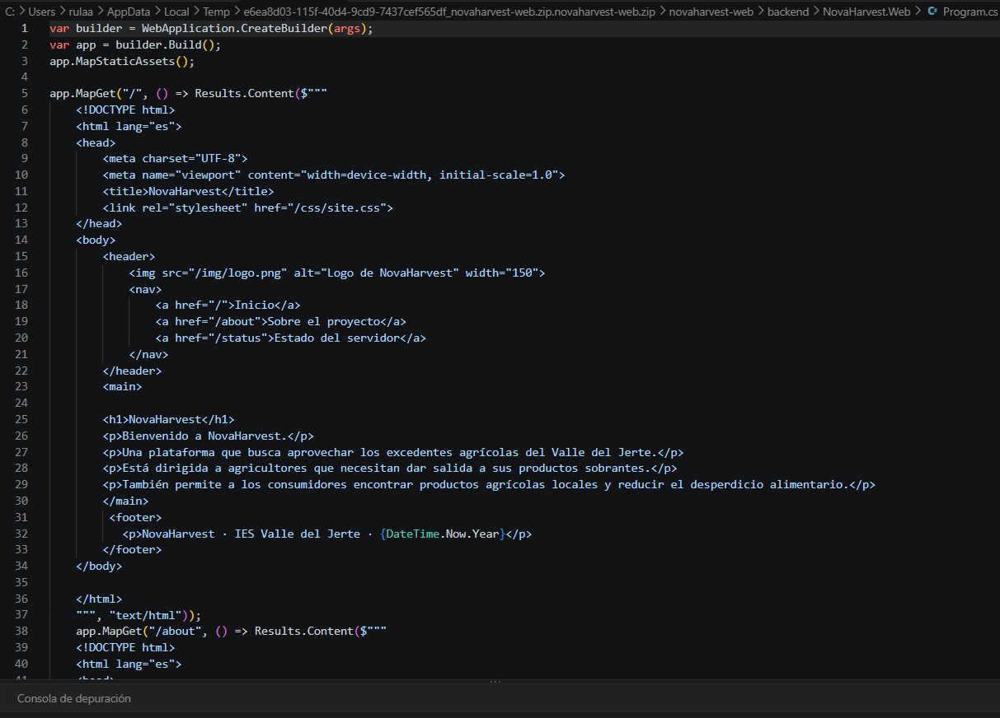

Además, `Program.cs` ahora es más sencillo, porque solo necesita configurar los servicios y las rutas de Razor Pages.


### 3. Etiquetas de código.
 Copia de tu proyecto un ejemplo de cada: expresión implícita,
expresión explícita, bloque @{ }, @@ y comentario @* *@, junto con el HTML que genera
cada uno (código fuente de la página). ¿Por qué info@novaharvest.es no necesita @@ y
@novaharvest sí?**

**a. Expresión implícita**

Se utiliza `@` seguido de una expresión C#. En `Pages/Status.cshtml`, en una línea que muestra una propiedad del modelo mediante `@Model`. 
```cshtml
<p>Servidor: @Model.ServerName</p>
<p>Visitas desde el arranque: @Model.Visits</p>
```


El HTML generado sería este.

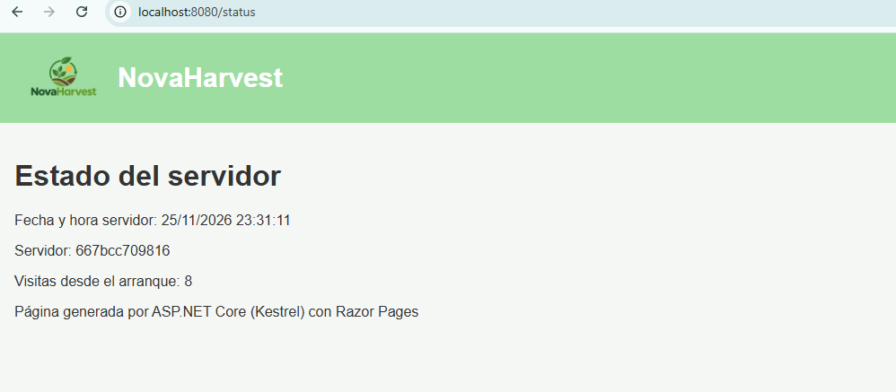

**b. Expresión Explícita**
 Hay que localizar en los archivos `.cshtml` una expresión escrita con `@(...)`. En el proyecto pongo como ejemplo. en /Pages/Surplus.cshtml

Código Razor:

```cshtml
<p>Nota del productor: @Html.Raw(Model.Excedente.Note ?? "Sin observaciones")</p>
```


El HTML generado sería.


**c. Bloque de código**
 
 Cada vez que he usado  @{ ---} se ejecuta como bloque de código.

 por ejemplo,
 ```cshtml
@{
    ViewData["Title"] = "Estado del servidor";
}
```
captura en el proyecto 


**d. caracter @@**
En el proyecto lo he usado en "About.cshtml" por ejemplo. es para  escapar la @.
```cshtml
 <p>Escríbenos a info@novaharvest.es o síguenos en @@novaharvest</p>
```

El el proyecto queda así


El Html quedaría 


**d. comentarios Razor**

Los comentarios en Razor son (@*   *@). En mi proyecto tengo un comentario por ejemplo en /Surplus
```cshtml
 @* boton aparece deshabilitado cuando el producto está agotado*@
<button disabled="@(!Model.PuedeReservar)">Reservar</button>

```

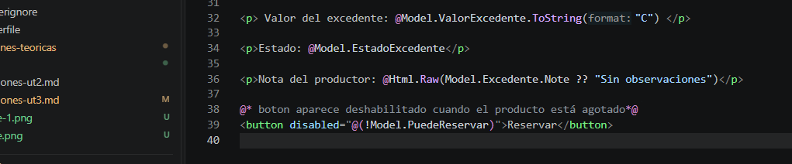

Comprobacion que no se ve el comentario.

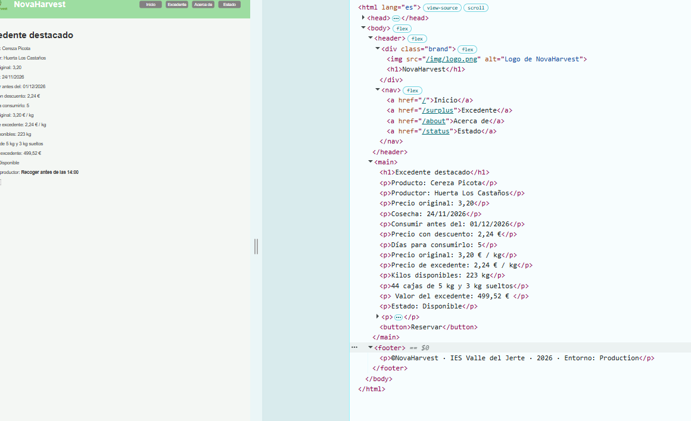

**¿Por qué info@novaharvest.es no necesita @@ y @novaharvest sí?**
En `info@novaharvest.es`, el símbolo `@` está precedido por texto, así que Razor lo reconoce como parte de una dirección de correo. Sin embargo, en `@novaharvest` aparece al principio y Razor puede confundirlo con una expresión de C#. Por eso se escribe `@@` cuando queremos mostrar una arroba sin que Razor la interprete como código.


### 4. Sintaxis.
 Haz estos dos cambios en Surplus.cshtml (y deshazlos después): escribe
@Model.SurplusPrize en lugar de @Model.SurplusPrice, y escribe
@Model.Surplus.PricePerKg * 0.7m en alguna línea. Copia lo que ocurre en cada caso
(el error de dotnet build o el HTML generado). ¿Por qué el primero no compila y el
segundo sí, aunque el resultado esté mal? ¿Cómo se corrige el segundo?

Al hacer la sustitución que el enuciado pide, cambio ` <p>Precio con descuento: @Model.PrecioExcedente.ToString("C")</p>` por `<p>Precio con descuento: @Model.SurplusPrize.ToString("C")</p>`ya que no usé el mismo nombre de las variables. Al ejecutar `dotnet run`, me genera  `error CS1061: "SurplusModel" no contiene una definición para "SurplusPrize" ni un método de extensión accesible "SurplusPrize" que acepte un primer argumento del tipo "SurplusModel" (¿falta alguna directiva using o una referencia de ensamblado?)`.  Este error al compilar debido a que  al buscar el nombre de la variable definida en `Surplus.cshtml.cs`no encuentra esa variable.

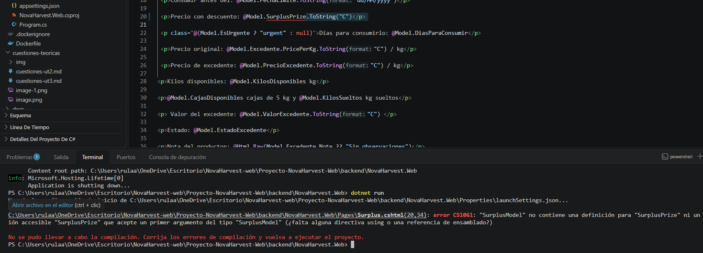

Si añadimos en mi caso `@Model.Excedente.PricePerKg * 0.7m` como prueba  en la linea justo debajo de lo que he probado anteriormente. Ejecuto `dotnet build`y me compila sin problemas. 


Compruebo el HTML generado y me aparece en Excedente `Prueba pregunta4: 3,20 * 0.7` debido a que Razor  lo separa en 2. Según los apuntes. primero coge como C# `@Model.Excedente.PricePerKg` y luego coge  la multiplicación con texto normal `*0.7m`. Por ese motivo no realiza la multiplicación en este caso. Para corregirlo sería metiendolo todo entre parentesis `@(Model.Excedente.PricePerKg * 0.7m)`

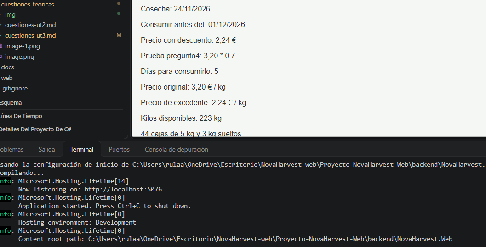

Quedaría así Corregido 
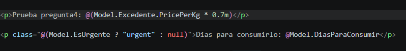


### 5. Efectos en el documento. 
Compara cómo se ve la nota del productor en pantalla y en el
código fuente de /surplus. ¿Qué ha hecho Razor y por qué? ¿Qué podría pasar si usaras
@Html.Raw y la nota la escribiera un usuario malintencionado? 

Lo primero que hago es hacer la prueba sin `@Html.Raw` y debajo  con `@Html.Raw` el resultado obtenido es que en el primero, Razor muestra la nota pero convierte los caracteres especiales en HTML para evitar que se interpreten como código HTML. En la segunda opción `<p>Nota del productor: @Html.Raw(Model.Excedente.Note ?? "Sin observaciones")</p>` . Html.Raw muestra el contenido sin realizar esa conversion. Por eso el navegador puede interpretarlas.

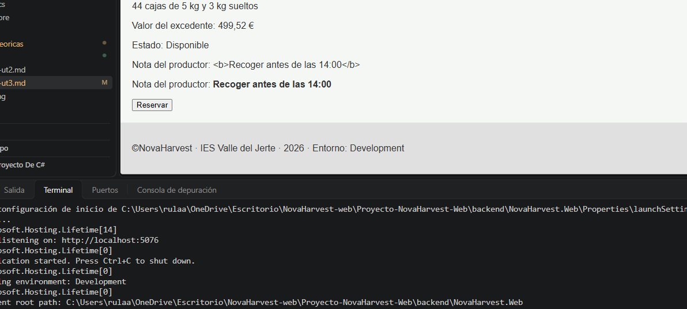


**¿Qué podría pasar si utilizáramos @Html.Raw y la nota la escribiera un usuario malintencionado?**
Un usuario podría introducir código HTML o JavaScript malicioso. Al utilizar Html.Raw, ese código podría ejecutarse en el navegador de otros visitantes, provocando un ataque XSS (Cross-Site Scripting).

**Copia el elemento de los días y el botón en los escenarios A, C y D, y explica por qué a veces el atributo class o**
**disabled no aparece.**

**Escenario A** No se modifica ningún dato. La página debe mostrar el resultado inicial.


Comprobacion


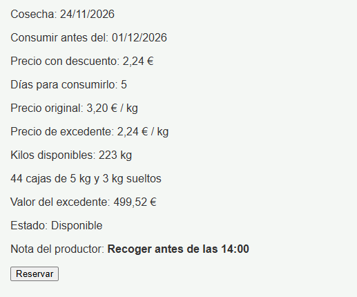


Esto ocurre porque Razor tiene un comportamiento especial: cuando el valor de un atributo HTML es null, no genera ese atributo.


**Escenario C:** 
ReservedKg = 343. Los kilos disponibles son 0, no hay cajas ni kilos sueltos, el valor del excedente es 0,00 €, el estado es «Agotado» y el botón aparece deshabilitado.

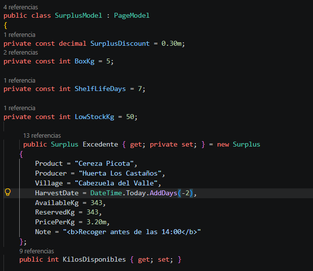

Comprobación


El boton aparece desabilitado y en nos aparece en en DevTools `<button disabled="disabled">Reservar</button>` porque no quedan kilos.


**escenario D** . Cambiar la fecha de cosecha para que sea de hace 6 días.


Comprobación

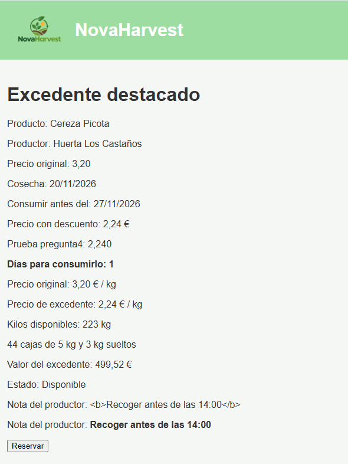


Cuando el valor de la expresión es null, Razor no muestra el atributo `class="urgent"`.Lo mismo ocurre con `disabled` cuando su valor es `false`.Como sólo queda un día para consumir el producto y todavía quedan existencias.

### 6. Directivas.
 Haz una tabla con cada directiva o fichero especial de tu proyecto (@page, @page "/ticket", @model, @using, @namespace, @inject, _ViewStart.cshtml y Layout = null) y el comportamiento por defecto que cambia. ¿Por qué /reservations/ticket da 404?

**Directivas y archivos de Razor Pages**

| **Directiva o fichero** | **comportamiento** |
| ----------------------- | ----------------------- |
| `@page` | La utilizo para indicar que ese archivo puede funcionar como una página web y tener una dirección propia. |
| `@page "/ticket"` | Me permite poner una dirección concreta a la página. Así puedo acceder a ella escribiendo `/ticket` en el navegador. |
| `@model` | La utilizo para enlazar el HTML con el archivo C# que contiene los datos y las operaciones de esa página. |
| `@using` | Me sirve para incluir las clases de otros espacios de nombres y poder utilizarlas directamente. |
| `@namespace` | Indica a qué espacio de nombres pertenece la página que Razor crea automáticamente al compilarla. |
| `@inject` | Me permite acceder desde la página a un servicio que ya proporciona ASP.NET Core, sin necesidad de crear una instancia por mi cuenta. |
| `_ViewStart.cshtml` | Es un archivo común que se ejecuta al cargar las páginas y permite indicar qué diseño general van a compartir. |
| `Layout = null` | Lo utilizo cuando quiero que una página se muestre por separado, sin incluir la estructura general del resto de la web. |


 **Quita @namespace de _ViewImports.cshtml: copia el error y explícalo.**

 
 

 Al quitar @namespace de _ViewImports.cshtml, Razor deja de utilizar el espacio de nombres que teníamos definido para las páginas. Como consecuencia, puede generar las clases de las páginas en un espacio de nombres diferente y no encontrar sus correspondientes clases PageModel. Pr ese motivo salta el `error CS0246`

  **¿Por qué /reservations/ticket da 404?**

  

 Porque en /Ticket.cshtml tengo configurado `@page "/ticket"`con lo que la URL donde Razor va a renderizar la Página es `localhost:8080/Ticket` y ponemos otra ruta qno sea esa mnos dará el `error 404`


 

### 7. Tipos y operadores.
 Haz una tabla con cada dato que calcula SurplusModel: su tipo de C#, los operadores que usa y por qué ese tipo. ¿Qué pasaría si los kilos fueran decimal? ¿Qué escribe Razor si muestras directamente un bool? ¿Y un null?

### Tipos de datos y operadores de SurplusModel

| **Dato que calcula** | **Tipo de C#** | **Operadores que usa** | **por qué ese tipo** |
|---|---|---|---|
| `Status` | `string` | `==`, `<`, `?:` | Guarda un mensaje de texto que indica la situación actual del excedente. |
| `RemainingKg` | `int` | `-` | Almacena los kilos que todavía están disponibles sin utilizar decimales. |
| `IsUrgent` | `bool` | `<=`, `&&`, `>` | Devuelve verdadero o falso según si el producto está próximo a caducar y quedan kilos. |
| `DiscountedPricePerKg` | `decimal` | `*`, `-` | Permite obtener el precio con descuento manteniendo los valores decimales. |
| `FullBoxes` | `int` | `/` | Indica cuántas cajas se pueden completar con los kilos disponibles. |
| `ConsumeBefore` | `DateTime` | `AddDays()` | Permite almacenar una fecha concreta que marca el límite para consumir el producto. |
| `IsOutOfStock` | `bool` | `==` | Sirve para comprobar si ya no queda ningún kilo disponible. |
| `LooseKg` | `int` | `%` | Guarda los kilos que quedan después de preparar todas las cajas completas. |
| `TotalValue` | `decimal` | `*` | Se utiliza para calcular el importe total del excedente con precisión decimal. |
| `DaysToConsume` | `int` | `-`, `.Days` | Representa el número de días que faltan hasta la fecha límite de consumo. |

**¿Por qué RemainingKg / BoxKg da cajas completas?** 

Porque los dos valores son de tipo `int`. En C#, cuando dividimos dos números enteros, el resultado también es entero y se eliminan los decimales.

Por ejemplo, si tenemos 43 kilos y cada caja contiene 5:

```csharp
43 / 5 = 8
```

El resultado es 8 cajas completas.

**¿Qué pasaría si los kilos fueran de tipo `decimal`?**

La división podría devolver un resultado con decimales. Por ejemplo:

```csharp
43m / 5m = 8.6m
```

Esto indicaría 8,6 cajas, pero no podemos preparar una caja incompleta si queremos contar únicamente las cajas completas. Para conseguirlo tendríamos que redondear hacia abajo o utilizar una conversión a entero.

### 8. Cultura.
 Quita UseRequestLocalization("es-ES") (y vuelve a ponerlo al terminar). Copia lo que muestran los precios de /surplus y la fecha de / con Docker y con dotnet run. Explica las diferencias y por qué esa línea las elimina.

 UseRequestLocalization("es-ES") es la localización que lo he usado para que al generar las páginas nos ponga la moneda del pais y el dia en el idioma al que hemos especificado. está en `Program.cs`

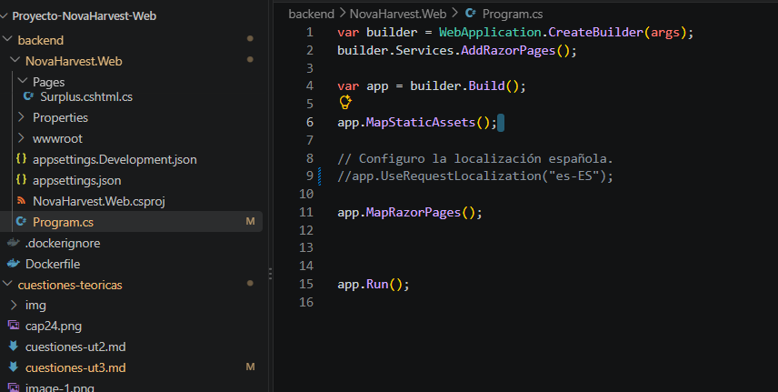

Si ejecuto con `Docker compose up -d --build`, la fecha aparecerá en inglés y los precios en vez de aparecer con la moneda de € . Aparecerá con un simbolo.

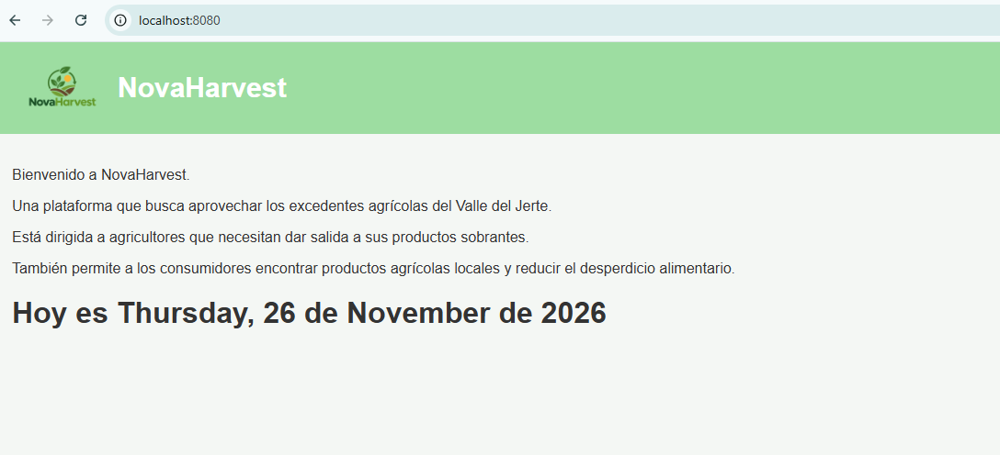

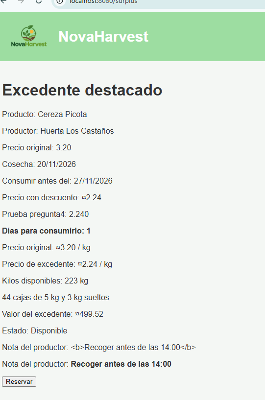


Si ejecuto con `Dotnet run`, los precios aparecen en € y la fecha en español.


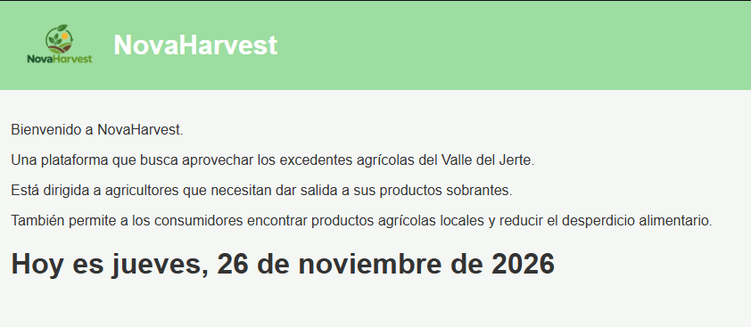

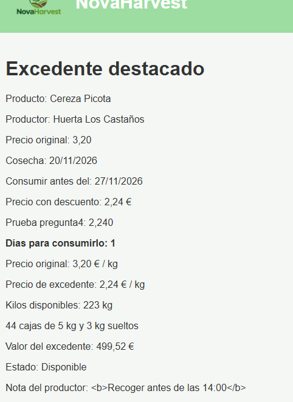

Con `dotnet run`: la aplicación se ejecuta directamente en Windows y normalmente utiliza la configuración regional del sistema operativo.

Con `Docker`: la aplicación se ejecuta dentro de un contenedor Linux, que puede tener otra configuración regional.

### 9. Ámbito.
 Cambia temporalmente el contador de /status por una variable local en un @{ } de la página y recarga varias veces: ¿qué ves y por qué? Con SiteStats, 

Para desarrollar el ejemplo. voy a poner el contador a 0 como lo hicimos en el proyecto de clase en /Status.cshtml debajo del ViwData. y en `visitas desde arranque`voy a indicarle que coja `@Visist`.Esa variable la he creado dentro de `@{ }`de manera local y el layout no puede acceder a dicha varible. de tal manera que al recargar la pagina varias veces la hora cambia pero el el número de visitas siempre se que da a 1.Lariable empieza en 0 y al pasar por ella incrementa una vez el contador. Al volver a cargar la página, vuelve el contador a empezar desde 0


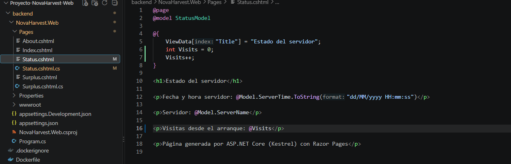

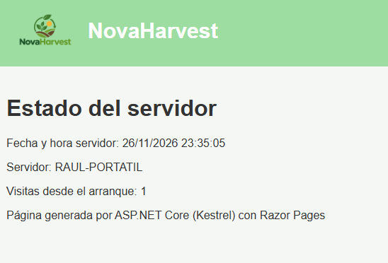

Para que el contador funcione como es debido al recargar la página. Necesitamos crear `/model/SiteStats.cs`. Donde nos creamos la clase Visits. 


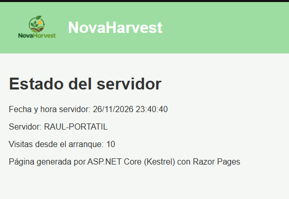

¿qué ve otro navegador, y qué pasa tras docker compose restart backend?
si ejecutas `docker compose restart`se reinicia el contador ya que se reinicia el contenedor  y la variable se vuelve a poner a 0 debido a que es una variable estática.

 ¿Por qué el layout no puede leer una variable declarada en Status.cshtml, y cómo le llega entonces el título?

 Tanto `_Layout.cshtml` como `Status.cshtml` son diferentes páginas . si declaro de modo local una variable en `Status.cshtml` en @ { } . En `_Layout.cshtml`no va a poder acceder.


### 10. PageModel.
 ¿Qué has puesto en SurplusModel y qué en Surplus.cshtml, y por qué? 
 En `SurplusModel.cshtml.cs`. He puesto el archivo c# donde contiene la lógica de la página de `Excedentes` que voy a utilizar en `Surplus.chtml`. Declaro las clase y las constantes que voy a usar e incluso el `OnGet()` donde se ejecuta los calculo cunado accedo a la página. 

 En  `SuperplusModel.cshtml` tengo el HTML donde cogerá los cáculos de `SuperplusModel.cshtml.cs`y el `_Layout.cshtml`y crearan la página que visualizará el usuario.

 [pregunta 10](img/cap42.png)
 
 Cita un cálculo concreto. Si cargas /surplus tres veces, ¿cuántos objetos SurplusModel se crean y cuánto vive cada uno? 
 Si cargo `/Surplus`tres veces , se crean 3 objetos `SurplusModel`. Se genera uno por cada petición. Cada objeto vive durante le tiempo que dura el procesamiento de la petición. 
 Si tomamos como  ejemplo 
 ```
    KilosDisponibles = Excedente.AvailableKg - Excedente.ReservedKg;
 
 ```
 En cada petición se realiza un cáculo de forma independiente. y con los datos que tiene en esas variables se hace el cálculo.

 343-120 = 223 kg disponible

 
 ¿Y el contador de SiteStats?
 El contador SiteStats.Visits funciona de forma diferente a SurplusModel. Si cargas /surplus 3 veces . se crean 3 objetos SurplusModel. pero el contador no se reinicia en cada petición por que es una propiedad `statica`. 

 SiteStats.Visits: es compartido por todas las peticiones y conserva su valor mientras el proceso de la aplicación siga activo.
