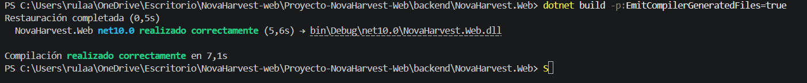
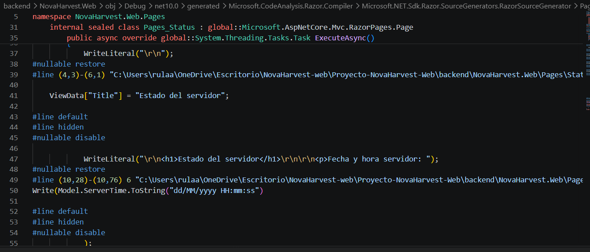
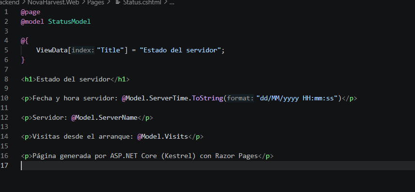
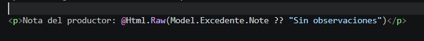

### 1. De .cshtml a HTML.
**Explica qué le pasa a Surplus.cshtml desde que haces dotnet
build hasta que el navegador recibe el HTML. Compila con dotnet build
-p:EmitCompilerGeneratedFiles=true, busca la clase generada para Status.cshtml y
copia un WriteLiteral y un Write: ¿de qué parte de tu .cshtml sale cada uno? ¿Por qué
no hay ningún .cshtml dentro del contenedor? ¿En qué ensamblado acaban las páginas, y en cuál acababan antes de .NET 6?**

Al ejecutar el comando `dotnet build -p:EmitCompilerGeneratedFiles=true`, el proyecto se compila y se genera el archivo `NovaHarvest.Web.dll`.



Durante la compilación, Razor transforma los archivos `.cshtml` en código C# y los compila. Para comprobarlo, he buscado los archivos generados dentro de la carpeta `obj/Debug/net10.0/generated`. Allí he encontrado las páginas con extensión `.g.cs`, como `Surplus_cshtml.g.cs` y `Status_cshtml.g.cs`.

Dentro de estas clases generadas aparecen los métodos `WriteLiteral()` y `Write()`.

El `WriteLiteral()` sale directamente del contenido HTML que he escrito en el archivo `.cshtml`, como las etiquetas y los textos.

El `Write()` sale de las expresiones Razor que empiezan por `@`, como `@Model.ServerTime.ToString("dd/MM/yyyy HH:mm:ss")`, y muestra el valor obtenido de esa expresión.

Cuando el navegador solicita una página, ASP.NET Core ejecuta el código compilado de Razor y genera el HTML que finalmente recibe el navegador.

No se ven `.cshtml` dentro del contenedor porque las páginas Razor ya se han transformado y compilado. La aplicación además usa el código compilado para ejecutarse, por lo que no necesita los archivos `.cshtml` originales.


**2. Tecnologías. Escribe la línea Precio de excedente: ... de tu página como se
escribiría en PHP y en ASP clásico, y compárala con la tuya en Razor: ¿cómo marca cada
una dónde empieza y dónde acaba el código? ¿Qué has ganado al pasar de los MapGet de
UT2 a Razor Pages? Compara tu Program.cs de antes y de ahora. Añade también esa línea escrita en ERB (Ruby on Rails).**
### 2. Tecnologías

En mi proyecto, la línea del precio en Razor es:

```cshtml
<p>Precio de excedente: @Model.PrecioExcedente.ToString("C") € / kg</p>
```

En PHP se utiliza:

```php
<p>Precio de excedente: <?php echo $precioExcedente; ?> € / kg</p>
```

En ASP clásico:

```asp
<p>Precio de excedente: <%= precioExcedente %> € / kg</p>
```

En ERB (Ruby on Rails):

```erb
<p>Precio de excedente: <%= @precio_excedente %> € / kg</p>
```

Cada tecnología utiliza diferentes marcas para indicar dónde empieza y termina el código. Razor utiliza `@` para introducir expresiones C#.

Al pasar de los `MapGet` de UT2 a Razor Pages he conseguido organizar mejor el proyecto, separando el HTML en archivos `.cshtml` y la lógica C# en archivos `.cshtml.cs`.
Así lo tenía antes las Páginas HTML


Además, `Program.cs` ahora es más sencillo, porque solo necesita configurar los servicios y las rutas de Razor Pages.


**3. Etiquetas de código. Copia de tu proyecto un ejemplo de cada: expresión implícita,
expresión explícita, bloque @{ }, @@ y comentario @* *@, junto con el HTML que genera
cada uno (código fuente de la página). ¿Por qué info@novaharvest.es no necesita @@ y
@novaharvest sí?**

**a. Expresión implícita**

Se utiliza `@` seguido de una expresión C#. En `Pages/Status.cshtml`, en una línea que muestra una propiedad del modelo mediante `@Model`. 
```cshtml
<p>Servidor: @Model.ServerName</p>
<p>Visitas desde el arranque: @Model.Visits</p>
```



El HTML generado sería este.


**b. Expresión Explícita**
 Hay que localizar en los archivos `.cshtml` una expresión escrita con `@(...)`. En el proyecto pongo como ejemplo. en /Pages/Surplus.cshtml

Código Razor:

```cshtml
<p>Nota del productor: @Html.Raw(Model.Excedente.Note ?? "Sin observaciones")</p>
```


El HTML generado sería.


**c. Bloque de código**
 
 Cada vez que he usado  @{ ---} se ejecuta como bloque de código.

 por ejemplo,
 ```cshtml
@{
    ViewData["Title"] = "Estado del servidor";
}
```
captura en el proyecto 


**d. caracter @@**
En el proyecto lo he usado en "About.cshtml" por ejemplo. es para  escapar la @.
```cshtml
 <p>Escríbenos a info@novaharvest.es o síguenos en @@novaharvest</p>
```

El el proyecto queda así


El Html quedaría 


**d. comentarios Razor**

Los comentarios en Razor son (@*   *@). En mi proyecto tengo un comentario por ejemplo en /Surplus
```cshtml
 @* boton aparece deshabilitado cuando el producto está agotado*@
<button disabled="@(!Model.PuedeReservar)">Reservar</button>

```


Comprobacion que no se ve el comentario.


¿Por qué info@novaharvest.es no necesita @@ y @novaharvest sí?
En `info@novaharvest.es`, el símbolo `@` está precedido por texto, así que Razor lo reconoce como parte de una dirección de correo. Sin embargo, en `@novaharvest` aparece al principio y Razor puede confundirlo con una expresión de C#. Por eso se escribe `@@` cuando queremos mostrar una arroba sin que Razor la interprete como código.


4. Sintaxis. Haz estos dos cambios en Surplus.cshtml (y deshazlos después): escribe
@Model.SurplusPrize en lugar de @Model.SurplusPrice, y escribe
@Model.Surplus.PricePerKg * 0.7m en alguna línea. Copia lo que ocurre en cada caso
(el error de dotnet build o el HTML generado). ¿Por qué el primero no compila y el
segundo sí, aunque el resultado esté mal? ¿Cómo se corrige el segundo?


5. Efectos en el documento. Compara cómo se ve la nota del productor en pantalla y en el
código fuente de /surplus. ¿Qué ha hecho Razor y por qué? ¿Qué podría pasar si usaras
@Html.Raw y la nota la escribiera un usuario malintencionado? Copia el elemento de los
días y el botón en los escenarios A, C y D, y explica por qué a veces el atributo class o
disabled no aparece. Para